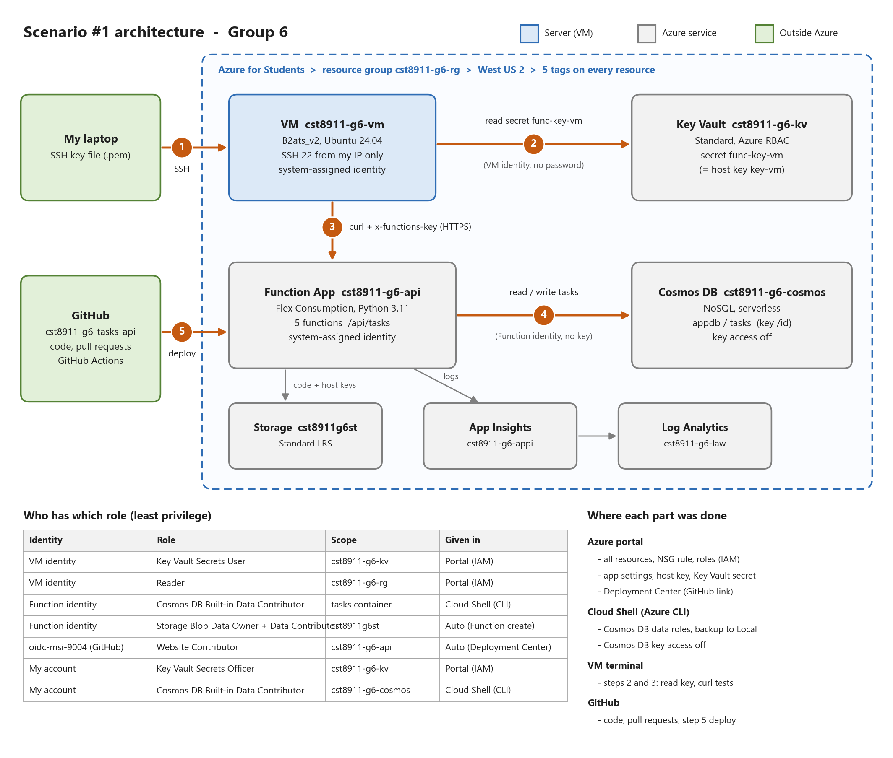

# CST8911 Midterm Project - Group 6 - Tasks API

Scenario 1: a REST API on Azure Functions that stores data in Azure Cosmos DB (serverless).
The Function App uses its system-assigned managed identity to access Cosmos DB, so there is
no connection string or key in the code. A virtual machine is the management station and
testing hub. The VM reads the function key from Azure Key Vault with its own managed identity
and tests the API with curl.

## Architecture



Numbers 1 to 5 are the main flow: SSH to the VM, read the key from Key Vault, call the API,
read and write Cosmos DB, and deploy from GitHub. The tables under the picture show which
identity has which role, and where each part was done.

All resources are in one resource group, `cst8911-g6-rg`, in West US 2.

## Data

One list called `tasks`. One document looks like this:

```json
{
  "id": "uuid",
  "title": "text",
  "status": "todo | doing | done",
  "owner": "text",
  "createdAt": "2026-10-15T14:00:00+00:00"
}
```

Cosmos DB: database `appdb`, container `tasks`, partition key `/id`.

## Endpoints

All routes start with `/api`. Auth level is `function`, so every request needs the header `x-functions-key`.
A request without a key returns 401.

| Method | Route | Written by | Success | Error |
|---|---|---|---|---|
| POST | `/api/tasks` | Hye Ran Yoo | 201 + the new task | 400 if `title` or `owner` is missing |
| GET | `/api/tasks` | Peng Wang | 200 + array (optional `?status=`) | - |
| GET | `/api/tasks/{id}` | Tao Lu | 200 + the task | 404 |
| PUT | `/api/tasks/{id}` | Tao Lu | 200 + the updated task | 404, 400 if `status` is not valid |
| DELETE | `/api/tasks/{id}` | David Yin | 204 (no body) | 404 |

## Project structure

```
function_app.py            registers all blueprints
shared/cosmos.py           returns the Cosmos DB container (managed identity)
functions/create_task.py   POST /api/tasks
functions/get_tasks.py     GET /api/tasks
functions/get_task.py      GET /api/tasks/{id}
functions/update_task.py   PUT /api/tasks/{id}
functions/delete_task.py   DELETE /api/tasks/{id}
tests/run_tests.sh         curl tests (the key comes from an environment variable)
data/tasks-sample.json     sample data
requirements.txt           azure-functions, azure-cosmos, azure-identity
host.json
.github/workflows/         GitHub Actions build and deploy
```

## Azure resources

| Resource | Name | Setting |
|---|---|---|
| Resource group | `cst8911-g6-rg` | West US 2 |
| Storage account | `cst8911g6st` | Standard, LRS (used by the Function App) |
| Cosmos DB | `cst8911-g6-cosmos` | NoSQL, serverless |
| Function App | `cst8911-g6-api` | Flex Consumption, Linux, Python 3.11, 512 MB |
| Application Insights | `cst8911-g6-appi` | logs for the Function App |
| Log Analytics workspace | `cst8911-g6-law` | stores the logs |
| Key Vault | `cst8911-g6-kv` | Standard, Azure RBAC |
| Virtual machine | `cst8911-g6-vm` | Standard_B2ats_v2, Ubuntu 24.04, Standard HDD |

All resources have the same five tags: `project`, `group`, `owner`, `env`, `cost-center`.

All Azure resources were deleted after the final test, so the endpoints in this README no longer respond.

## Settings used by the Function App

| Name | Value |
|---|---|
| `COSMOS_ENDPOINT` | `https://cst8911-g6-cosmos.documents.azure.com:443/` |
| `COSMOS_DATABASE` | `appdb` |
| `COSMOS_CONTAINER` | `tasks` |

There is no Cosmos DB key in the settings. The Function App identity has the
Cosmos DB Built-in Data Contributor role on the `tasks` container only. Key-based access
to Cosmos DB is turned off.

## Deployment

A push to `main` runs GitHub Actions. The workflow builds the app and deploys it to the
Function App. GitHub signs in to Azure with a managed identity (OpenID Connect), so no
password or publish profile is stored in GitHub. Remote build is on, so Azure installs
the packages from `requirements.txt`.

## How to test

On the VM, the key is read from Key Vault with the VM's managed identity:

```bash
TOKEN=$(curl -s -H Metadata:true "http://169.254.169.254/metadata/identity/oauth2/token?api-version=2018-02-01&resource=https%3A%2F%2Fvault.azure.net" | jq -r .access_token)
export KEY=$(curl -s -H "Authorization: Bearer $TOKEN" "https://cst8911-g6-kv.vault.azure.net/secrets/func-key-vm?api-version=7.4" | jq -r .value)
export BASE=https://<function-app-host>
bash tests/run_tests.sh
```

Do not write a key in any file or commit.

## How to add a function

1. Make a branch from the latest `main`, for example `git checkout -b feature/delete-task`.
2. Add one file in `functions/`. Create `bp = func.Blueprint()` and use `get_container()` from `shared/cosmos.py`.
3. In `function_app.py`, add the import line and the `app.register_functions(...)` line.
4. Push the branch and open a pull request. When it is merged into `main`, GitHub Actions deploys it.

## Team

| Name | Work |
|---|---|
| Hye Ran Yoo | Azure resources, managed identities and roles, Key Vault, VM, POST function, GitHub deployment, tests from the VM |
| Tao Lu | GET one and PUT functions, curl test script, architecture diagram |
| Peng Wang | GET list function, README |
| David Yin | DELETE function, final check of the report against the instructions |
| All members | Report |
